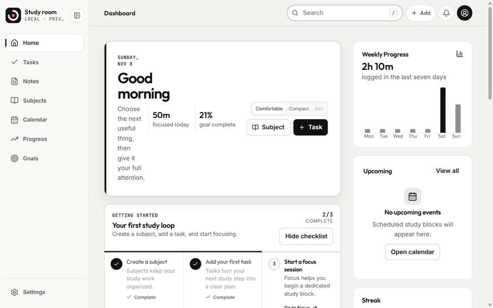
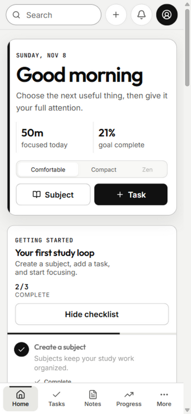

# Study Dashboard

A free, local-first study workspace that runs entirely in your browser. Tasks, subjects, notes,
a calendar, focus sessions, and progress views — all in one place, with your data stored only
on your own device.

**Status: limited public beta** (`v1.5.0-beta.1`). Core features are stable and covered by a
large automated test suite, but wider browser/device coverage and manual screen-reader
certification are still in progress. See [Known limitations](#known-limitations).

| | |
|---|---|
| **Try it** | [sankalpa-kmcp.github.io/StudyApp](https://sankalpa-kmcp.github.io/StudyApp/) — installable as a web app |
| **Feedback** | [GitHub Issues](https://github.com/sankalpa-kmcp/StudyApp/issues) |


[](https://github.com/sankalpa-kmcp/StudyApp/releases)
[](#known-limitations)

## Screenshots

Screenshots show synthetic sample data, not real study records.

**Home dashboard (desktop)** — greeting, today's focus summary, weekly study chart, and the
getting-started checklist:



**Home dashboard (mobile)** — the same dashboard adapts to small screens with bottom
navigation:



## Features

- **Tasks** with due dates, priorities, and time estimates.
- **Subjects** with colors, target hours, and progress tracking — manual percentage or
  automatically calculated from logged study time.
- **Notes** with tags, and a **calendar** with upcoming events.
- **Focus timer** (Pomodoro-style, open-ended mode, subject linking) with pause/resume;
  running and paused sessions survive reloads and browser restarts, and stale sessions offer
  Resume or Discard.
- **Goals** with manual points or automatic study-time progress (daily / weekly / monthly).
- **Progress views**: weekly study-time chart, streaks, and a study journal with manual
  session logging, correction, and deletion.
- **21 accessible themes** (11 light, 10 dark — Monochrome is the default), including five
  with live wallpapers, plus Comfortable/Compact/Zen density modes.
- **Backup export/import**: download all data as a JSON file and restore it any time; imports
  are fully validated before anything is replaced.
- Bookmarkable workspace paths (such as `/StudyApp/tasks`) and a local-date calendar that
  refreshes after midnight without a reload.

## Privacy and data ownership

- **Everything is stored locally in your browser** (IndexedDB). There is no account, no
  server, no cloud sync, and no telemetry — your data never leaves your device.
- The flip side of local-only storage: clearing browser data (or using private/incognito
  mode) deletes your study data. Export backups regularly from **Settings → Export** and keep
  the file somewhere safe.
- Details: [docs/data-management.md](docs/data-management.md) and
  [docs/storage-isolation.md](docs/storage-isolation.md).

## Accessibility

Keyboard-accessible navigation and core study workflows, a skip link, and visible focus
indicators. Tasks and Goals associate field-level validation errors with the responsible
inputs. All 21 themes include verified text and control-boundary contrast. The app respects
`prefers-reduced-motion` and `prefers-reduced-transparency`, and keeps focused controls clear
of the fixed mobile bottom navigation. Automated accessibility smoke checks (axe) cover
representative Home, Settings, and Progress states in Playwright.

These are accessibility improvements and checks — not a claim of universal WCAG certification
across every browser or assistive technology.

## Known limitations

- **Fully tested:** Chrome and Edge on Windows.
- **Not yet fully verified:** Firefox, Safari, and mobile browsers. No manual screen-reader
  session has been done yet.
- Refreshing a bookmarked page (e.g. `/StudyApp/tasks`) works correctly, but browsers may
  briefly show a "404" in the network log before the page recovers — harmless and expected on
  GitHub Pages.
- An export is a snapshot of the moment you clicked; anything you do after exporting is only
  in the next export.

## Run locally

Requires Node.js 22 and npm 10 (`.npmrc` keeps `engine-strict=false`, so other versions are
not rejected automatically, but the supported toolchain is Node `^22.0.0` and npm 10.9.2 —
matching CI).

```bash
npm ci          # install dependencies
npm run dev     # dev server at http://localhost:5173
```

Other commands:

| Command | Description |
|---------|-------------|
| `npm test` | Unit tests |
| `npm run lint` | ESLint |
| `npm run build` | Production build |
| `npm run check:bundle` | Bundle size budget |
| `npm run test:e2e` | Playwright end-to-end tests |

Normal local development does not require a `.env` file.

## Documentation

- [CONTRIBUTING.md](CONTRIBUTING.md) — project invariants, testing, and data-safety rules
- [docs/data-management.md](docs/data-management.md) — goals, subjects, focus sessions, and
  backup format details
- [docs/storage-isolation.md](docs/storage-isolation.md) — storage isolation and security notes
- [docs/architecture.md](docs/architecture.md) — app structure and CSS architecture
- [docs/release-v1.5.0-contract.md](docs/release-v1.5.0-contract.md) — v1.5.0 release contract
- [CHANGELOG.md](CHANGELOG.md) — release notes
- [SECURITY.md](SECURITY.md) — how to report security concerns

## Feedback

Found something broken, confusing, or odd? Please open a
[GitHub Issue](https://github.com/sankalpa-kmcp/StudyApp/issues) with what you did, what
happened, and your browser and version (e.g. "Edge 157 on Windows 11"). Reports about data
loss get priority — mention it in the title.
